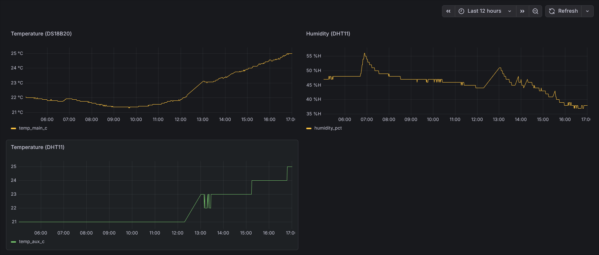
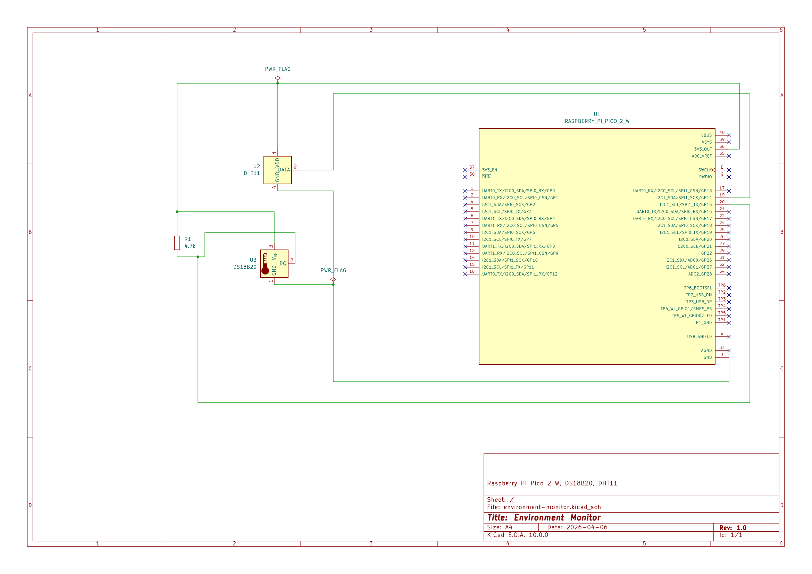

# Environment Monitor
Wifi environmental monitoring system for a water cooled homelab.

## Hardware
- Raspberry Pi Pico 2 W
- DS18B20
- DHT11

## Software
- MicroPython
- InfluxDB
- Grafana
- Uptime Kuma
- ntfy

## What it does
This project collects temperature and humidity data from a Pico 2 W sensor node and sends telemetry to a Debian monitoring stack for storage, graphing, and alerting.

## Sensors
- DS18B20: main temperature sensor
- DHT11: auxiliary temperature and humidity sensor

## Dashboard

## Schematic

[Open the full PDF schematic](environment-monitor.pdf)
